# Applying DDD with Jakarta EE: Strategic and Tactical Design with Jakarta Data

Domain-Driven Design (DDD) helps teams build software around a shared model of a
business domain. This article is for Java developers who want to see how DDD
concepts shape a Jakarta EE application. It follows a small library example from
requirements through design, implementation, and tests.

You should be comfortable with Java and basic Jakarta EE. You don't need prior
DDD experience. If DDD is new to you, start with Martin Fowler's
[Domain-Driven Design overview](https://martinfowler.com/bliki/DomainDrivenDesign.html)
or the
[introduction by Dan Haywood](https://www.dddcommunity.org/learning-ddd/haywood_2010/)
listed by the DDD Community. This article focuses on one sample; it isn't a
complete guide to DDD or a production-ready library system.

Strategic design helps you understand the domain, agree on its language, and
choose model boundaries. Tactical design applies those decisions in code, using
building blocks such as entities, value objects, aggregates, repositories, and
domain events. These activities inform each other; they aren't separate phases
that you complete once. Jakarta EE provides infrastructure for implementing
these patterns, and Jakarta Data lets you declare repository interfaces instead
of writing common persistence implementations by hand.

Parts 0 and I introduce the library requirements and design without framework
code. Part II maps those decisions to Jakarta EE. Part III describes the
scenarios verified by integration tests and gives the commands to run `LibraryIT`
on GlassFish and WildFly.

The example is
[`jakartaee-ddd-example`](https://github.com/hantsy/jakartaee-ddd-example), a
library system with cataloging and lending contexts. It adapts the example from
Maciej Walkowiak's
[Spring IO 2024 talk, *Implementing Domain-Driven Design with Spring*](https://www.youtube.com/watch?v=VGhg6Tfxb60)
([source code](https://github.com/maciejwalkowiak/implementing-ddd-with-spring-talk))
to Jakarta EE 11.

---

## Part 0 — Requirements

The requirements use a short story and an event-storming summary. The story
provides context; the event storm identifies commands, events, policies, and
actors. Numbered scenarios make it possible to compare the requirements with the
tests in Part III.

### 0.1 The story

> It is Monday morning and the library has just received a new shipment. Priya,
> the cataloging librarian, picks up *Effective Java* and types its ISBN into
> the desk terminal. She does not type the title — the system looks it up in the
> external bibliographic service and fills it in. If the number is wrong, or the
> book is already on the catalog, the system tells her and changes nothing. She
> then sticks four barcodes on four physical copies and registers each one. All
> four go on the shelf as available.
>
> At lunchtime Sam borrows one of the four. The desk scans the barcode, and a
> loan opens for thirty days. That copy immediately leaves the shelf — if Priya
> looks at the catalog she will see three available, not four. If Sam's friend
> tries to borrow the same physical copy a minute later, the desk refuses: that
> copy is out. The other three are unaffected.
>
> Six weeks later Sam brings it back. The desk closes the loan and the copy goes
> back on the shelf. Because it is almost two weeks late, a fee is charged —
> and the amount depends on how late it is. A week late costs less than a month
> late. The fee belongs to that loan, not to Sam as a person and not to the copy:
> the same copy returned on time by another borrower costs nothing.
>
> Meanwhile the other three copies have been borrowed and returned a dozen times
> each. The catalog entry for *Effective Java* has not changed once.

Three details guide the design:

- Priya never retypes a title, and a failed lookup leaves no half-created entry.
- The shelf and the loans are two different concerns that must nonetheless agree.
- A fee is a property of one loan, decided once, at the moment of return.

### 0.2 The event storm

The diagram uses common event-storming conventions associated with Alberto
Brandolini. Commands represent requests, events record what happened, and
policies connect events to follow-up commands.

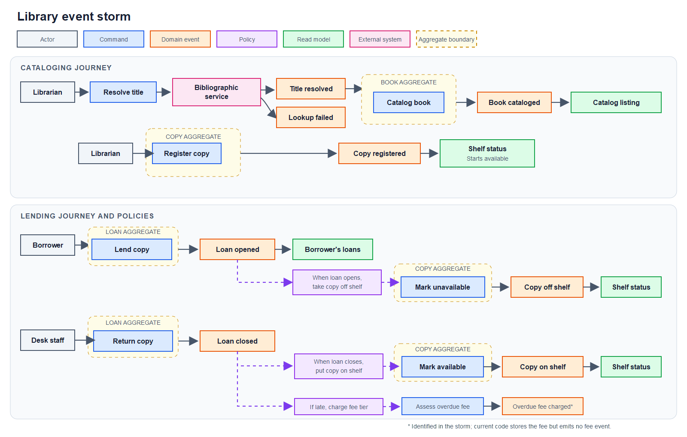

The overdue-fee event is identified in the requirements, but the current code
stores the fee on the loan without publishing an event.

#### The storm, tabulated

The color-coded table summarizes the events, commands, policies, read models,
and external system in the storm. The colors match the event-storm diagram
above.

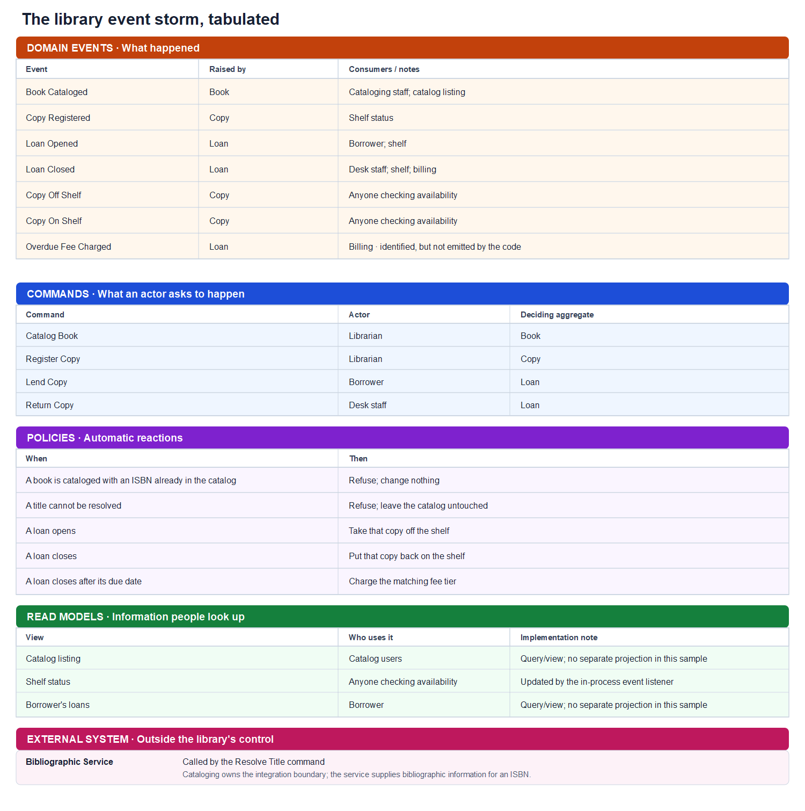

The overdue-fee event is identified in the requirements but isn't published by
the current code. The listed read models describe information users need; the
sample doesn't implement separate event-fed projections.

### 0.3 Journeys and acceptance scenarios

The numbered IDs in the following scenarios make it easier to discuss them in
Part III.

#### J1 — Catalog a book by ISBN

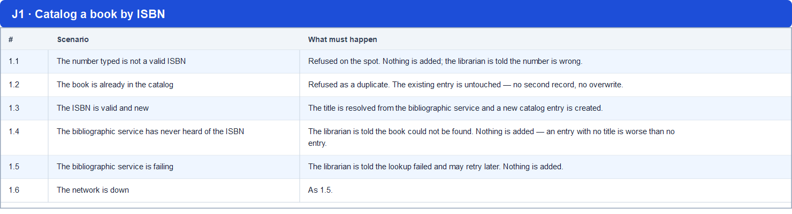

**Business rule.** Cataloging a book is all-or-nothing. If the title cannot be
resolved, no partial entry is left behind for someone to clean up later.

#### J2 — Register a physical copy

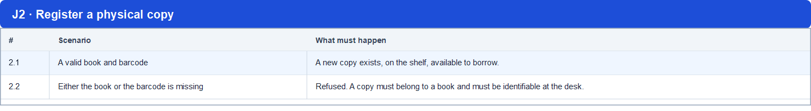

**Business rule.** A copy can only be registered against a book that is already
in the catalog. *Whether the system enforces this is a separate question — see
Part III.*

#### J3 — Lend a copy

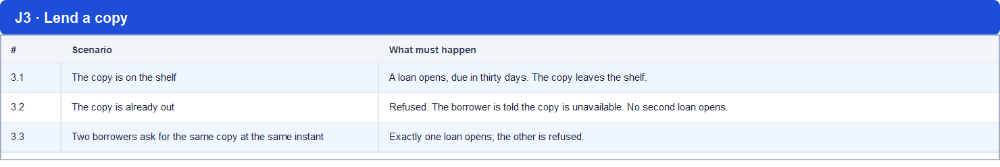

**Business rules.** A copy is on at most one open loan at a time. The due date is
always thirty days out. Lending is atomic — either the loan exists *and* the copy
is off the shelf, or neither is true.

#### J4 — Return a copy

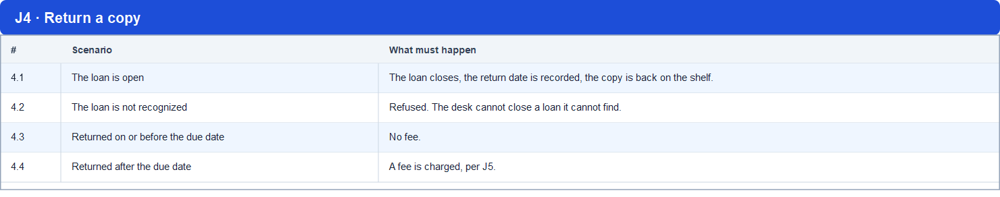

#### J5 — The overdue fee

The library charges a flat fee based on the number of days a copy is overdue:

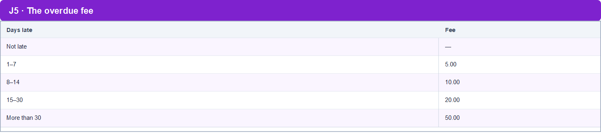

**Business rules.** The fee is a flat tier amount, not a per-day accrual. It is
decided once, at the moment of return. It belongs to the loan — not to the copy,
and not to the borrower.

---

## Part I — Strategic design

Strategic design uses conversations with domain experts to understand the
business, define the model, and identify its boundaries. Teams revisit these
decisions as they learn more; strategic design doesn't have to finish before
implementation begins. This section focuses on the domain rather than on
framework details.

### 1. Subdomain classification

DDD distinguishes three kinds of subdomain. The classification helps a team
decide where to invest in custom software and where to use an existing solution:

- **Core:** the part of the business that provides its main competitive
  advantage. A team usually invests in a model tailored to its needs.
- **Supporting:** necessary for the business, but not a source of competitive
  advantage. A team can build a focused solution or adapt an existing one.
- **Generic:** a common problem with established solutions. A team can buy,
  adopt, or integrate a standard solution instead of building one from scratch.

These classifications depend on the organization. For this example, assume the
library treats lending as its core subdomain, cataloging as supporting, and
bibliographic lookup as generic:

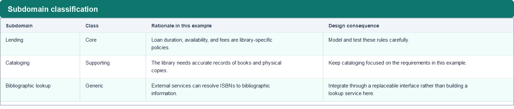

The diagram separates the business subdomains from the software model boundaries.
In this example, the subdomains don't map one-to-one to bounded contexts:
cataloging owns the port to the external bibliographic service, so lookup has no
separate context.

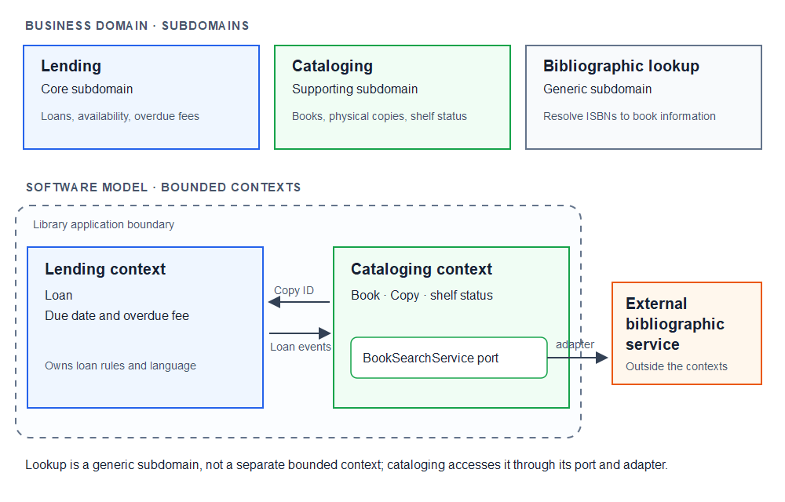

This classification helps prioritize design effort. Lending has the most
business-specific policies in this example, so the model focuses on loan
availability and overdue fees. The bibliographic lookup sits behind an
interface, which makes the provider easier to replace.

The example doesn't include user management. A borrower appears only as an
identifier on a loan; authentication, profiles, and notifications are outside
its scope. A real team would classify those capabilities based on its own
business and existing systems.

A subdomain partitions the business problem; a bounded context defines where a
particular model and its language apply. They can align, but they don't have to.
Here, the bibliographic lookup subdomain has no separate context. Cataloging
owns the interface to the external provider.

### 2. Ubiquitous language

The team uses the following terms consistently in its conversations,
requirements, and code:

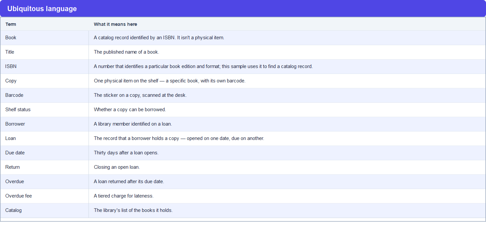

The model distinguishes a catalog record from each physical item:
**a book isn't a copy.** A library can hold one catalog record for
*Domain-Driven Design* and four physical copies. Each copy has its own barcode
and availability.

The glossary also clarifies two terms that could otherwise be ambiguous:

- **Available:** In this example, a copy is available when it has no open loan.
- **Return:** Returning a copy closes a loan. The return date is recorded
  separately and determines whether the loan is overdue.

Part II shows where these terms appear in the code. Each context has its own
`CopyId` type to make the context boundary explicit.

### 3. Bounded contexts

The example separates cataloging and lending because they model different
concerns:

**Cataloging** models the library's holdings: which books it records, which
physical copies belong to them, and whether each copy is available.

**Lending** models who has a copy and when it is due. It handles loan
availability, return dates, and overdue fees.

These concerns suggest separate bounded contexts in this example:

1. **The word "copy" means different things to them.** To cataloging, a copy is
   a physical asset with a barcode and a shelf status. Lending stores only a
   copy identifier on a loan. The same word appears in both contexts, but each
   context uses a different model.
2. **They change for different reasons.** A fee-tier change affects lending; a
   title correction affects cataloging. Keeping the models separate limits
   unnecessary dependencies between those changes.
3. **They could have different owners.** A larger system might assign different
   teams, storage, or scaling requirements to each context.

The `library.shared` package contains cross-cutting technical types, including
the `@UseCase` stereotype, `DomainException`, and the clock producer. It is a
shared technical package, not a DDD shared kernel: it doesn't contain a shared
part of the cataloging or lending domain model.

### 4. Context map

The contexts exchange copy identity and loan events in opposite directions.
These are in-process relationships in this sample, not independently deployed
services.

**Lending depends on cataloging for identity.**

Lending must be able to say *which* copy is on loan, so it stores a copy
identifier. Cataloging owns that identity; lending represents it with its own
`CopyId` type.

Lending doesn't model barcodes or update cataloging's availability flag.

**Cataloging depends on lending for facts.**

Cataloging updates a copy's availability flag when it receives a loan event.
When lending announces that a loan opened, the listener marks the copy
unavailable; when lending announces that a loan closed, it marks the copy
available.

`DomainEventListener` is the cataloging class that imports lending event types.
The contexts don't read each other's database tables, but they do share event
types. CDI delivers those events synchronously in this application. If you
deploy the contexts as separate services, design message delivery, retries, and
consistency guarantees; CDI events don't provide those guarantees.

### 5. What the strategy commits us to

These design choices guide the implementation:

1. **Three subdomains.** In this example, lending is core, cataloging is
   supporting, and bibliographic lookup is generic.
2. **Two bounded contexts and a shared technical package.** Cataloging and
   lending use separate models and exchange identifiers and announcements.
3. **One language per context.** Cataloging models a physical copy; lending
   refers to that copy by an identifier.
4. **A context map with explicit dependencies.** Lending stores copy identities;
   cataloging subscribes to lending's events. `DomainEventListener` owns the
   event dependency in cataloging.
5. **Cataloging updates shelf status** when it receives a lending event.
6. **The generic subdomain sits behind a boundary cataloging owns**, so the
   provider can be swapped or bought without touching the model.

Part II applies these choices to entities, value objects, aggregate boundaries,
repositories, and domain events.

---

## Part II — Tactical design with Jakarta EE

Tactical design represents the domain model in code. The example uses entities,
value objects, aggregates, repositories, domain events, domain services, and
application services. Jakarta EE supplies infrastructure mechanisms for these
patterns; Jakarta Data provides the repository API used in this sample.

### From design decisions to code

The following image maps the design choices from Part I to their implementation:

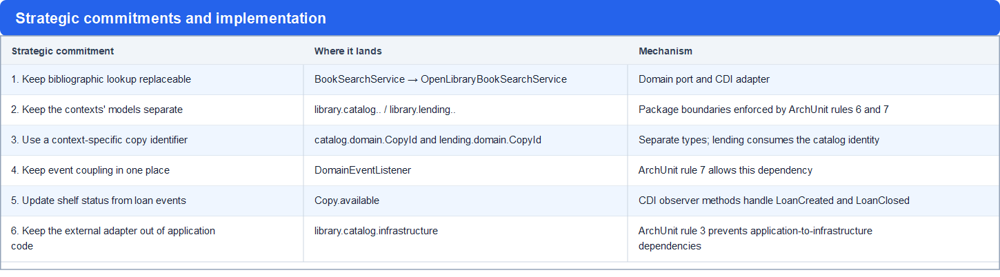

The tactical building blocks and their Jakarta EE mechanisms are summarized
here:

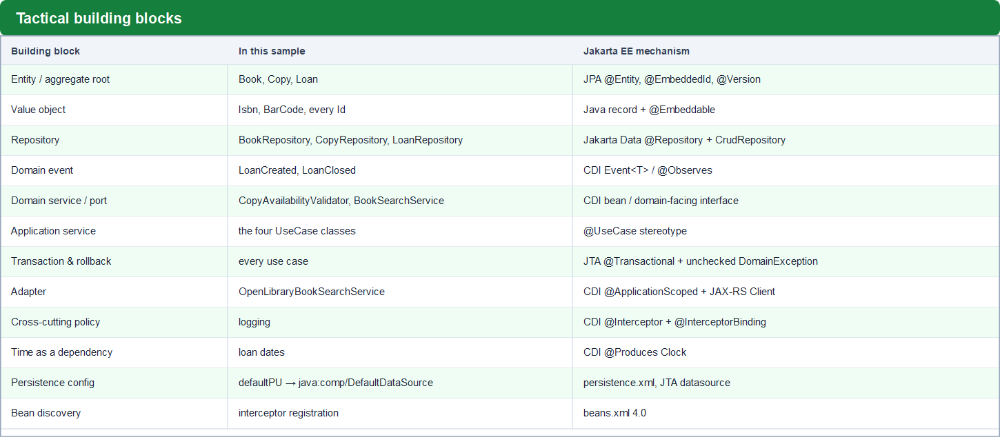

The building blocks in the second image each get a section in Part II.

### 1. Entities, value objects, and aggregate roots with JPA

#### Which concepts are entities and which are values

Ask whether the model needs to distinguish two instances that have the same
attributes. If not, they can be values. If the model tracks each instance
separately as it changes, it is an entity.

**Entities.** The model has three entity types, each serving as an aggregate
root:

- **Book** — a catalog record for a book edition. Its identity remains the
  same if the title or other details change.
- **Copy** — a physical item with its own identity and barcode. A library can
  hold several copies of one book; each copy has its own availability.
- **Loan** — a record with its own lifecycle. It opens, remains open until the
  copy is returned, and stores its return date and any overdue fee.

**Value objects.** The model represents the following concepts as values:

- **ISBN** and **BarCode** — immutable values that identify a book edition and a
  physical copy.
- **Identifiers** — values used to refer to books, copies, borrowers, and loans.
- **A bibliographic lookup result** — a snapshot of the information returned by
  the external service.
- **A fee tier** — a value representing the amount charged for a range of
  overdue days.
- **Loan events** — immutable records of facts such as a loan opening or closing.

This model uses three entity types and represents several other concepts as
values. This is a choice for the example, not a general target ratio for DDD
models.

#### Aggregate boundaries

An aggregate is a consistency boundary with one root. The root protects the
aggregate's invariants when the application changes its state. Invariants that
cross aggregate boundaries need a separate consistency strategy.

In this example, the boundaries exclude related objects:

**A copy does not contain its book.** A copy stores the book's identifier. This
keeps copy registration and book updates in separate aggregates.

**A loan does not contain a copy or a borrower.** A loan is a lending fact. It
stores the copy and borrower identifiers. Lending doesn't own the cataloging
copy or update its barcode.

The example follows this rule:

> **Aggregates refer to each other by identity, never by containment.**

Keeping aggregate references as identifiers helps transactions update one
aggregate at a time. It doesn't by itself enforce cross-aggregate invariants such
as allowing only one open loan per copy.

#### Invariants and their guards

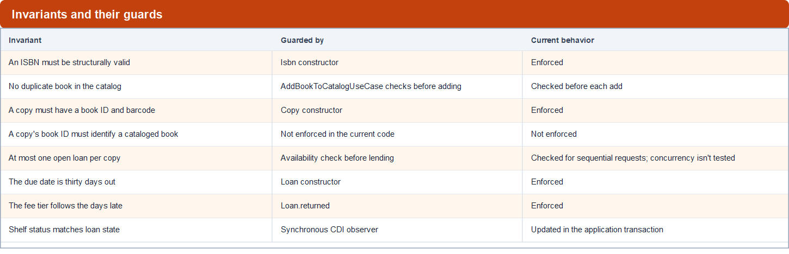

The image distinguishes checks the current implementation performs from a
requirement it doesn't enforce. The availability check prevents a second loan
for sequential requests; the sample doesn't include a concurrent-rental test.
The synchronous CDI observer updates shelf status in the same application
transaction. Separate services would need a different consistency strategy.

#### Map the model with JPA

Value objects keep the entity mapping focused on the domain model:

```java
@Entity
public class Book {
    @EmbeddedId
    private BookId id;
    private String title;
    @Embedded
    @AttributeOverride(name = "value", column = @Column(name = "isbn"))
    private Isbn isbn;

    Book() { }

    public Book(String title, Isbn isbn) {
        Objects.requireNonNull(title, "title must not be null");
        Objects.requireNonNull(isbn, "isbn must not be null");
        this.id = new BookId();
        this.title = title;
        this.isbn = isbn;
    }

    @Override
    public boolean equals(Object o) {
        if (this == o) return true;
        if (o == null || getClass() != o.getClass()) return false;
        return Objects.equals(id, ((Book) o).id);
    }

    @Override
    public int hashCode() { return Objects.hashCode(id); }
}
```

The details that matter:

- **The no-arg constructor is package-private in this sample.** The Jakarta
  Persistence specification requires a public or protected no-arg constructor
  for an entity. Although the providers used by this project accept the
  package-private constructor, use `protected` if you want to follow the
  specification and improve portability.
- **`equals`/`hashCode` compare identity only.** `Book` does not compare title
  or ISBN. That is what "entity" means, and getting it wrong is a classic
  source of `Set` corruption in JPA.
- **No setters.** `Copy` exposes `makeAvailable()` / `makeUnavailable()`, never
  `setAvailable(boolean)`. The method name carries the intent, and callers
  cannot put a copy into an arbitrary state for an arbitrary reason.
- **`@AttributeOverride`** disambiguates the column when the same embeddable
  type appears twice (`Loan` holds both a `CopyId` and a `UserId`, and both
  records wrap a field named `id`).

Records work as `@Embeddable` value objects with the providers tested by this
project: EclipseLink 5.0.2 (GlassFish) and Hibernate 7.4 (WildFly Preview).

### 2. Repositories with Jakarta Data

Jakarta Data provides repository interfaces that a Jakarta EE runtime implements.

**The entire persistence layer for the catalog context:**

```java
package library.catalog.domain;

import jakarta.data.repository.CrudRepository;
import jakarta.data.repository.Query;
import jakarta.data.repository.Repository;
import jakarta.transaction.Transactional;

@Repository
@Transactional
public interface BookRepository extends CrudRepository<Book, BookId> {

    @Query("select count(*) > 0 from Book where isbn = :isbn")
    boolean existsByIsbn(Isbn isbn);
}
```

```java
@Repository
@Transactional
public interface CopyRepository extends CrudRepository<Copy, CopyId> {
}
```

`CopyRepository` is four lines and contains no members. It still gives you the
whole `CrudRepository` contract — `save`, `saveAll`, `insert`, `insertAll`,
`update`, `updateAll`, `delete`, `deleteAll`, `deleteById`, `findById`,
`findAll()`, and `findAll(PageRequest, Order)`.

**There is no implementation class anywhere in the source tree.** You inject the
interface like any other CDI bean:

```java
@Inject private BookRepository bookRepository;
```

#### How the runtimes implement the repository

The distinction between the API and its implementation is important:

> **Jakarta Data is a specification, not a library.**  The implementation is supplied by the **runtime**, which means the same four-line interface is realized by different mechanisms depending on which server you deploy to.

On GlassFish, the EclipseLink processor generates only the static metamodel at compile time. The repository interfaces go into the WAR with nothing beside them. There is a Eclipse JNoSQL extension that provides Jakarta Data support for both Jakarta Peristence and Eclipse JNoSQL at runtime.  **EclipseLink generates no repository implementation at all.**

On WildFly, with the hibernate processor, **it generates a real repository implementation class at compile time.** Here is the actual output for `BookRepository` interface, lightly trimmed:

```java
@Dependent
@Generated("org.hibernate.processor.HibernateProcessor")
@jakarta.transaction.Transactional
public class BookRepository_ implements BookRepository {

    /** @see #existsByIsbn(Isbn) */
    static final String EXISTS_BY_ISBN_Isbn = "select count(*) > 0 from Book where isbn = :isbn";

    protected @Nonnull StatelessSession session;

    @PersistenceUnit
    private EntityManagerFactory sessionFactory;

    @PostConstruct
    private void openSession() {
        session = sessionFactory.unwrap(SessionFactory.class).openStatelessSession();
    }

    @PreDestroy
    private void closeSession() { session.close(); }

    @Inject
    BookRepository_() { }

    @Override
    public <S extends Book> S save(@Nonnull S entity) {
        requireNonNull(entity, "Null entity");
        try {
            session.upsert(entity);
        } catch (StaleStateException _ex) {
            throw new OptimisticLockingFailureException(_ex.getMessage(), _ex);
        } catch (PersistenceException _ex) {
            throw new DataException(_ex.getMessage(), _ex);
        }
        return entity;
    }

    @Override
    public boolean existsByIsbn(Isbn isbn) {
        try {
            return session.createSelectionQuery(EXISTS_BY_ISBN_Isbn, boolean.class)
                          .setParameter("isbn", isbn)
                          .getSingleResult();
        } catch (NoResultException _ex) {
            throw new EmptyResultException(_ex.getMessage(), _ex);
        } catch (NonUniqueResultException _ex) {
            throw new jakarta.data.exceptions.NonUniqueResultException(_ex.getMessage(), _ex);
        } catch (PersistenceException _ex) {
            throw new DataException(_ex.getMessage(), _ex);
        }
    }

    @Override
    public Optional<Book> findById(@Nonnull BookId id) {
        requireNonNull(id, "Null id");
        return ofNullable(session.get(Book.class, id));
    }
    // findAll(), findAll(PageRequest, Order), deleteById(BookId), insert*/update*/delete* …
}
```

Seven things in that output are worth noticing:

1. **It is a concrete class in the same package as the interface**, CDI
   `@Dependent`-scoped, and stamped `@Generated("org.hibernate.processor.HibernateProcessor")`.
2. **Lifecycle is generated, not inherited.** A `@PersistenceUnit
   EntityManagerFactory` is unwrapped to a Hibernate `SessionFactory` and a
   `StatelessSession` is opened in `@PostConstruct`, closed in `@PreDestroy`.
   *Stateless* is the right choice for a repository: no persistence context, no
   first-level cache, detached results.
3. **`save()` is `session.upsert()`** — the insert-or-update semantics Jakarta
   Data promises, mapped onto the provider's primitive.
4. **The `@Query` text is hoisted into a `static final` constant** and compiled
   into `createSelectionQuery(…)`. Your JPQL becomes a typed, parameterised
   Hibernate query at build time.
5. **Exception translation is generated too.** `ConstraintViolationException` →
   `EntityExistsException`, `StaleStateException` →
   `OptimisticLockingFailureException`, `NoResultException` →
   `EmptyResultException`, `PersistenceException` → `DataException`. Every
   provider-specific failure becomes a `jakarta.data.exceptions.*` type — the
   same anti-corruption discipline the sample applies by hand in
   `OpenLibraryBookSearchService` (§4.3), here done for you.
6. **Pagination is already implemented.** `findAll(PageRequest, Order)` builds a
   criteria query, applies sorts via `SelectionSpecification`, counts only when
   `pageRequest.requestTotal()` asks it to, and returns a `PageRecord`.
7. **Default methods remain available.** The generated class implements the
   interface, so it inherits `LoanRepository.findByIdOrThrow` without generated
   code.

#### Compare the implementation approaches

WildFly uses the Hibernate Processor to generate repository implementations at
compile time, while GlassFish uses the Eclipse JNoSQL extension to create
repository proxies reflectively at runtime.

#### Replace a hand-written repository

Without a repository implementation supplied by the runtime, a project can write
an adapter like this:

```java
// the file you no longer need
@ApplicationScoped
public class JpaBookRepository implements BookRepository {
    @PersistenceContext private EntityManager em;

    public Book save(Book book) {
        if (em.find(Book.class, book.getId()) == null) {
            em.persist(book);
            return book;
        }
        return em.merge(book);
    }
    public Optional<Book> findById(BookId id) {
        return Optional.ofNullable(em.find(Book.class, id));
    }
    public boolean existsByIsbn(Isbn isbn) {
        return em.createQuery("select count(*) > 0 from Book where isbn = :isbn", Boolean.class)
                 .setParameter("isbn", isbn).getSingleResult();
    }
    // …and the same shape again for every other aggregate
}
```

This implementation translates repository calls into JPA operations. Jakarta
Data removes the need to maintain that adapter in this sample, while the
repository interface remains part of the application contract.

#### Practical repository patterns

**a) `@Query` returns the domain's type, not the database's.**

```java
@Repository
@Transactional
public interface LoanRepository extends CrudRepository<Loan, LoanId> {

    @Query("select count(*) = 0 from Loan where copyId = :id and returnedAt is null")
    boolean isAvailable(CopyId id);

    default Loan findByIdOrThrow(LoanId loanId) {
        return findById(loanId).orElseThrow(() -> new LoanNotFoundException(loanId));
    }
}
```

`existsByIsbn` and `isAvailable` return `boolean`, not a `Long` you compare
against zero at every call site. The predicate lives in the query where it
belongs.

**b) A `default` method turns a generic API into a domain API.**

`CrudRepository.findById` returns `Optional<Loan>` — correct, but it pushes the
"what if it is missing?" decision onto every caller. `findByIdOrThrow` decides
once, and decides *in domain terms*: a missing loan is a `LoanNotFoundException`,
which extends the shared base:

```java
public abstract class DomainException extends RuntimeException { … }
```

Because it is unchecked, throwing it out of a `@Transactional` use case rolls the
transaction back automatically — no `@ApplicationException` needed. That is the
entire purpose of the base class: callers react to typed failures instead of
parsing `Optional.empty()` or catching a generic `NoSuchElementException`. And
it needs no separate implementation — it is an interface default method.

**c) The repository interface lives in `..domain..`.**

This feels wrong the first time. In hexagonal terms the repository is a **port**:
the domain declares what it needs ("store and retrieve books") and the platform
supplies the adapter. Jakarta Data makes the adapter invisible, so only the port
remains — and a port belongs to the domain.

It is not left to convention:

```java
@Test
void repositoryContractsMustResideInDomainLayer() {
    ArchRule rule = classes().that().haveSimpleNameEndingWith("Repository")
            .should().resideInAPackage("..domain..")
            .because("a Repository is a domain contract; its implementation belongs to the infrastructure layer");
    rule.check(classes);
}
```

#### Why `@Transactional` appears on the interface

The annotation makes each repository method transactional when called on its
own. Inside an active use-case transaction, the default `REQUIRED` behavior joins
that transaction. The use case still coordinates the loan save and event; the
repository can also be called from another transactional component.

#### Other Jakarta Data repository options

The sample uses `CrudRepository`. Jakarta Data also defines `BasicRepository`
for common save, delete, and retrieval operations, and `DataRepository` as a
base for custom repository interfaces. It also supports derived query methods
and pagination types such as `Page`, `PageRequest`, `Order`, and
`CursoredPage`. Add these features when the application needs them. For example,
storing configurable fee tiers would require a persistence model and repository;
the current sample keeps fee tiers in code.

### 3. Domain events with CDI events

#### Events in this example

The model emits two events that cataloging uses:

- **A loan was opened.** Carries: which copy.
- **A loan was closed.** Carries: which copy.

Both carry the copy identifier that cataloging needs to update availability.
Keeping the payload focused limits what subscribers depend on.

A third fact, an overdue fee calculation, is recorded on the loan but isn't
published as an event. If billing or notifications need to react to it, the
design could add an event and a subscriber.

Events let lending publish a fact without calling cataloging directly. In this
sample, CDI observers deliver that fact inside the same application. Moving the
contexts into separate services would require a messaging adapter and decisions
about delivery guarantees and transaction boundaries.

#### Publish and observe CDI events

CDI provides synchronous, type-safe events. This sample uses them directly; it
doesn't use a broker or an outbox.

The events are immutable records:

```java
public record LoanCreated(CopyId copyId) { }
public record LoanClosed(CopyId copyId) { }
```

The publisher injects a typed `Event<T>`:

```java
@UseCase
public class RentBookUseCase {
    private final LoanRepository loanRepository;
    private final CopyAvailabilityValidator copyAvailabilityValidator;
    private final Event<LoanCreated> loanCreatedEvent;
    private final Clock clock;

    public RentBookUseCase() { }

    @Inject
    public RentBookUseCase(LoanRepository loanRepository,
                           CopyAvailabilityValidator copyAvailabilityValidator,
                           Event<LoanCreated> loanCreatedEvent,
                           Clock clock) { … }

    public void execute(CopyId copyId, UserId userId) {
        copyAvailabilityValidator.checkAvailable(copyId);
        var now = LocalDateTime.now(clock);
        loanRepository.save(new Loan(copyId, userId, now));

        loanCreatedEvent.fire(new LoanCreated(copyId));
    }
}
```

The subscriber declares observer methods:

```java
@ApplicationScoped
public class DomainEventListener {

    public void onLoanCreated(@Observes LoanCreated event) { … }
    public void onLoanClosed(@Observes LoanClosed event) { … }
}
```

This approach has several useful properties:

- **Synchronous by default.** The observer runs while the event is fired. In
  this sample, it updates availability within the use-case transaction.
- **Type-safe and compile-checked.** `Event<LoanCreated>` cannot fire a
  `LoanClosed` by accident; a string topic name can.
- **The publisher knows nothing about subscribers.** `RentBookUseCase` has no
  import from `library.catalog`. Add a second listener — audit log, search index,
  metrics — and the lending context does not change.
- **Changing delivery requires design work.** An asynchronous observer or
  message broker changes delivery and transaction behavior; the publisher and
  event contract may also need an adapter.

The `execute` method validates availability, creates and persists a loan, and
publishes the event. The `@UseCase` stereotype supplies the transaction and
logging behavior.

### 4. Domain and application services with CDI

Domain services and application services have different responsibilities.

An **application service** coordinates a use case. In this sample, it starts a
transaction, invokes domain behavior, persists the result, and publishes events.

A **domain service** implements domain behavior that doesn't belong naturally
to one entity or value object. A **port** is different: it's an interface the
domain declares for a capability supplied from outside the model. An adapter
implements that interface.

The sample's application services—`AddBookToCatalogUseCase`,
`RegisterBookCopyUseCase`, `RentBookUseCase`, and `ReturnBookUseCase`—orchestrate
their respective journeys. `CopyAvailabilityValidator`, in
`library.lending.domain`, is a domain service that checks the open-loan rule
through `LoanRepository`. `BookSearchService`, in `library.catalog.domain`, is a
port for retrieving book information from an external source; its infrastructure
adapter implements that capability.

#### 4.1 Application services and the `@UseCase` stereotype

Each use case uses the `@UseCase` CDI stereotype, which combines transaction,
scope, and logging annotations:

```java
@Target(ElementType.TYPE)
@Retention(RetentionPolicy.RUNTIME)
@Documented
@Stereotype
@Transactional
@ApplicationScoped
@Logged
public @interface UseCase { }
```

In this application, `@UseCase` gives each use case application scope and a
transaction. The `@Logged` interceptor adds entry, exit, and exception logging.
The interceptor is registered in `beans.xml`:

```xml
<interceptors>
    <class>library.shared.LoggedInterceptor</class>
</interceptors>
```

The stereotype keeps these annotations consistent across use cases and gives the
architecture tests a single annotation to check.

#### 4.2 Domain services and cross-aggregate rules

"At most one open loan per copy" (scenario 3.2) depends on other loans for the
same copy, so `Loan` cannot check it by inspecting only its own state. The
`CopyAvailabilityValidator` domain service uses the repository to check for an
existing open loan.

```java
@ApplicationScoped
public class CopyAvailabilityValidator {
    private LoanRepository loanRepository;

    CopyAvailabilityValidator() { }

    @Inject
    public CopyAvailabilityValidator(LoanRepository loanRepository) {
        this.loanRepository = loanRepository;
    }

    public void checkAvailable(CopyId copyId) {
        if (!loanRepository.isAvailable(copyId)) {
            throw new CopyNotAvailableException(copyId);
        }
    }
}
```

The validator raises `CopyNotAvailableException` when the repository reports
that the copy is unavailable. The exception extends the unchecked
`DomainException` base class.

#### 4.3 Ports and adapters with CDI and the JAX-RS client

Journey J1 needs to resolve an ISBN to a title. The cataloging domain declares
the capability it needs:

```java
// library.catalog.domain — the port
public interface BookSearchService {
    BookInformation search(Isbn isbn);
}
```

The interface doesn't expose HTTP or JSON details. The infrastructure adapter
handles those details:

```java
// library.catalog.infrastructure — the adapter
@ApplicationScoped
public class OpenLibraryBookSearchService implements BookSearchService {

    public BookInformation search(Isbn isbn) {
        var targetUri = UriBuilder.fromUri(baseUrl + "isbn/{isbn}.json").build(isbn.value());
        try (var response = getFollowingRedirects(targetUri)) {
            if (response.getStatus() == Response.Status.NOT_FOUND.getStatusCode()) {
                throw new BookNotFoundException(isbn);
            }
            if (response.getStatus() != Response.Status.OK.getStatusCode()) {
                throw new BookSearchException(
                        "failed to search book, upstream returned status " + response.getStatus());
            }
            var result = response.readEntity(OpenLibraryIsbnSearchResult.class);
            return new BookInformation(result.title());
        } catch (ProcessingException e) {
            throw new BookSearchException("failed to search book for isbn: " + isbn.value(), e);
        }
    }
}
```

The adapter translates HTTP failures into domain exceptions: a 404 becomes
`BookNotFoundException`; other unsuccessful responses and connection failures
become `BookSearchException`. `AddBookToCatalogUseCase` handles domain
exceptions rather than HTTP status codes.

The adapter also follows Open Library's redirect to `/books/{key}.json` and
resolves relative `Location` headers against the request URI. These HTTP details
stay in the infrastructure layer.

Because the constructor accepts a base URL, the adapter is testable without a
network — which is what the WireMock tests exploit in Part III.

### 5. Packages and ArchUnit rules

Eric Evans describes a four-layer architecture: user interface, application,
domain, and infrastructure. This example applies that organization inside each
bounded context rather than creating one set of layers for the whole application.
The cataloging and lending contexts each have application and domain packages;
infrastructure appears where an adapter is needed. The generic bibliographic
lookup subdomain has no separate context, and this example has no user-interface
layer.

The package tree also shows the shared technical package:

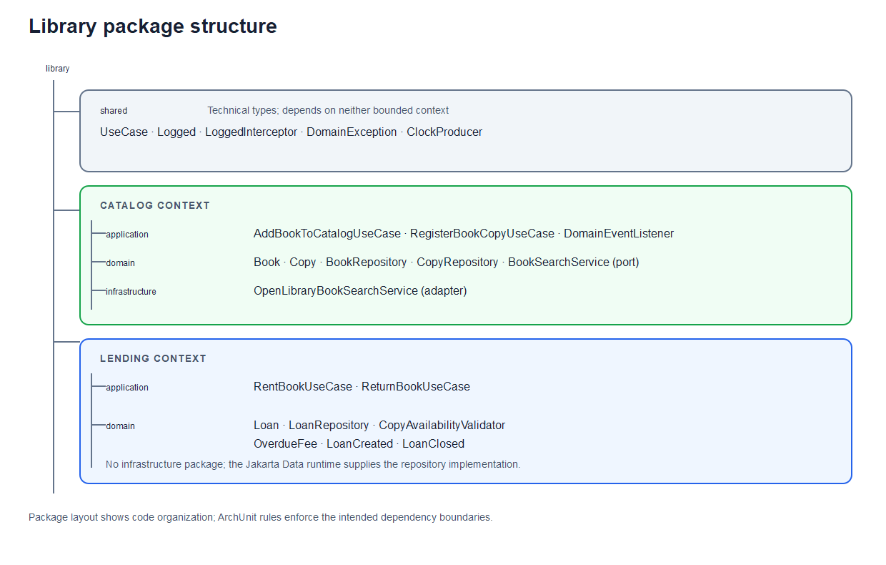

The lending context has no infrastructure package in this sample. Its repository
interface is implemented by the Jakarta Data runtime; the application still
requires persistence-provider and datasource configuration. The source tree also
doesn't contain a hand-written `BookRepository` adapter.

Packages don't enforce module boundaries by themselves. Eight ArchUnit rules run
as unit tests during `mvn package` and fail the build when a dependency rule is
violated:

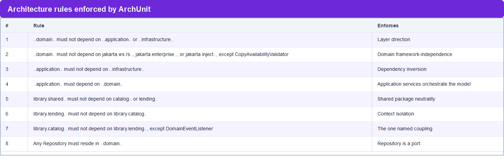

Rule 7 documents the event-listener exception:

```java
@Test
void catalogContextMustNotDependOnLendingContextExceptObservedEvents() {
    ArchRule rule = noClasses().that().resideInAnyPackage("library.catalog..")
            .and().doNotBelongToAnyOf(DomainEventListener.class)
            .should().dependOnClassesThat().resideInAnyPackage("library.lending..")
            .because("the only allowed coupling between the contexts is the catalog observing lending "
                    + "domain events (LoanCreated/LoanClosed) via DomainEventListener to update copy availability");
    rule.check(classes);
}
```

The contexts do communicate, so a blanket ban would fail. Whitelisting
`DomainEventListener` makes the dependency visible and reviewable.

#### The trade-off in rule 2

Rule 2 doesn't ban `jakarta.persistence`. `Book`, `Copy`, and `Loan` use
`@Entity`; `Isbn` and `BarCode` use `@Embeddable`. The domain model includes JPA
annotations.

This is a trade-off. A separate persistence model and mapper layer would avoid
JPA annotations in the domain but add types and mapping code. Here, the domain
depends on the JPA API, but not directly on either persistence provider.

The rule also allows one exception: `CopyAvailabilityValidator` uses CDI as a
domain service. The model remains coupled to JPA mapping rules, including
`@AttributeOverride` and the entity constructor visibility requirement.

---

## Part III — Verify scenarios with integration tests

`LibraryIT` runs the application use cases in a container with a database. It
verifies these lending scenarios:

- **Rent and return a copy:** the test saves a book and two copies as fixtures,
  rents one copy, verifies that one loan is recorded and the copy becomes
  unavailable, returns the loan, and verifies that the copy becomes available
  again.
- **Reject a second rental:** the test attempts to rent the same copy again and
  checks that the call throws. The assertion uses `Exception.class`, so it
  doesn't confirm that the failure is specifically `CopyNotAvailableException`.
- **Charge a fee for a late return:** the test returns a loan whose due date was
  35 days earlier and verifies the returned timestamp and `BEYOND_A_MONTH` fee.

The tests create book and copy fixtures directly through the repositories, so
they don't verify the cataloging use cases for adding books or registering
copies. They also don't test concurrent rentals or enforce the stated rule that
a copy must belong to a cataloged book.

To run `LibraryIT`, use the command for your target runtime:

- Run `LibraryIT` on GlassFish 8 with `mvn clean verify -Parq-glassfish-managed`.
- Run `LibraryIT` on WildFly Preview with `mvn clean verify -Parq-wildfly-managed`.

---

## Summary

This example shows how DDD helps shape a library application around distinct
cataloging and lending models, and how Jakarta EE technologies can implement
those boundaries. Integration tests exercise the main lending scenarios on two
runtimes, while also highlighting requirements the current implementation does
not yet enforce or test.

Source code: [hantsy/jakartaee-ddd-example](https://github.com/hantsy/jakartaee-ddd-example).

### Further reading

- [Implementing Domain-Driven Design with Spring](https://www.youtube.com/watch?v=VGhg6Tfxb60),
  Maciej Walkowiak's Spring IO 2024 talk that inspired this example.
- [Domain-Driven Design](https://martinfowler.com/bliki/DomainDrivenDesign.html)
  by Martin Fowler provides an overview of DDD concepts.
- [An Introduction to Domain-Driven Design](https://www.dddcommunity.org/learning-ddd/haywood_2010/)
  by Dan Haywood is an introductory article listed by the DDD Community.
- [*Domain-Driven Design: Tackling Complexity in the Heart of Software*](https://www.amazon.com/dp/0321125215)
  by Eric Evans (Addison-Wesley, 2003) introduced many of the patterns used in
  this article.
- [DDD Reference](https://www.domainlanguage.com/ddd/reference/) by Eric Evans
  is a concise pattern reference for readers who already know the basics.
